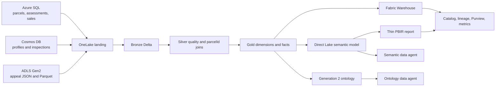

# Property Assessment Fabric Hacker Lab

Build an end-to-end Microsoft Fabric property-assessment platform from **explicitly fictional** Sudsberry records. The lab uses Azure SQL, Cosmos DB, and ADLS Gen2 sources; OneLake; a medallion Lakehouse; a Warehouse; a Direct Lake semantic model; a thin report; a Generation 2 ontology; two data agents; and governance/operations evidence.

**Target:** `MaddysWS` (`930bbe6f-b256-46b7-a70e-f3dcab99d2c9`)  
**Time:** 3-5 hours locally; 5-8 hours with Azure/Fabric deployment and preview UI work.  
**Safety:** no real owners, addresses, parcels, valuations, or tax advice. Never add credentials to this folder.

## Architecture and build order



```text
0 Foundation -> 1 Data -> 2 Sources/OneLake -> 3 Lakehouse -> 4 Warehouse
             -> 5 Semantic model/report -> 6 Ontology -> 7 Data agents
             -> 8 Governance, verification, teardown
```

## Prerequisite gate

- Python 3.10+, PowerShell 7+, Azure CLI, and optionally `sqlcmd`.
- Contributor rights for Azure source deployment, including role assignments.
- Fabric workspace Contributor or Admin rights and capacity-backed `MaddysWS`.
- Tenant switches for Fabric REST APIs, service principals (if used), Data Agent, and Ontology preview as applicable.
- Power BI Desktop with PBIP/TMDL support if editing the report/model locally.

```powershell
cd .\property-assessment-fabric
python -m pip install -r .\requirements.txt
.\scripts\preflight.ps1
python .\scripts\generate_data.py --scale 240 --seed 20261013
python .\scripts\validate_lab.py
python -m pytest .\tests -q
```

Pass only when preflight, validation, and tests succeed. Copy `.env.example` to an untracked `.env` only if your shell tooling uses it. Fabric authentication uses complete process-scoped OAuth client credentials first, Azure CLI second, and noninteractive `DefaultAzureCredential` last. Partial client-credential configuration is rejected. Never write the real client secret to `.env`, shell history, logs, source files, or ownership state.

## Numbered lab

| Step | Objective and command | Explore | Evaluation checkpoint and evidence |
|---|---|---|---|
| [0](docs/00-foundation.md) | Prove tools, auth design, configuration, and ownership safety. `.\scripts\preflight.ps1` | Which actions require workspace Admin versus Contributor? | Screenshot/console output showing local preflight pass; explain `.state` ownership guard. |
| [1](docs/01-synthetic-data.md) | Generate credible multi-source data. `python .\scripts\generate_data.py --scale 240 --seed 20261013` | Which classes have the widest assessment-to-sale ratios? | `data/generated/manifest.json`, validation pass, expected counts 240/480/80/240/300. |
| [2](docs/02-onelake-sources.md) | Upload deterministic fixtures to owned OneLake Files with `python .\scripts\prepare_gold.py` after core items exist; optionally deploy Azure sources/shortcuts. | Compare JSON nesting, relational keys, and Parquet schema in Files. | Uploaded-path evidence or a documented access blocker; no secrets. |
| [3](docs/03-lakehouse.md) | `prepare_gold.py` binds/updates and runs `PropertyAssessmentMedallion`, then verifies Delta logs. | Find nulls, duplicates, unknown `parcelId`s, and enrichment opportunities. | Job completion evidence and five Gold Delta tables. |
| [4](docs/04-warehouse.md) | Create `PropertyAssessmentWarehouse` and run `fabric/Property Assessment Warehouse/deploy.sql`. | Query neighborhood equity and appeal resolution. | Object explorer plus three successful exploration queries. |
| [5](docs/05-semantic-model.md) | Stage the owned model ID into PBIR, deploy TMDL/report definitions, test measures and RLS. | Compare ResidentialReviewer and CommercialReviewer. | Model/report readback, measure results, two persona screenshots. |
| [6](docs/06-ontology.md) | Deploy Gen2 shell where REST preview is enabled; bind Gold entities in UI. | Explain Parcel -> Assessment and Parcel -> Appeal. | Ontology readback or precise preview/access blocker plus binding screenshot. |
| [7](docs/07-data-agents.md) | Stage owned workspace/source IDs, deploy schema-valid drafts, test, then publish in UI. | Ask governed, adversarial, and persona-specific prompts. | Definition readback plus prompt transcript with expected shape and synthetic warning. |
| [8](docs/08-governance-operations.md) | Capture lineage/catalog/Purview/metrics evidence and verify/teardown safely. | Identify the heaviest notebook stage and upstream impact. | Evidence pack, item IDs/status codes, and ownership-restricted teardown proof. |

## Automation boundary

**Automated:** deterministic generation; JSON/Parquet/contract checks; Azure resource shell; identity-based source seeding; OneLake fixture upload; notebook Lakehouse binding/run; Gold readiness; Fabric item create/update for supported definitions; live ID staging for Direct Lake, PBIR, and Data Agent drafts; definition readback verification; owned-item state; dry run; local tests; owned-item teardown.

**Manual or tenant-dependent:** connection credentials; SQL/Cosmos mirroring eligibility; shortcut connection selection; Warehouse `deploy.sql` execution/data load; RLS membership; PBIR visual refinement; Ontology-to-Gold entity/property binding; Data Agent testing and publish; Catalog endorsement, Purview evidence, and Capacity Metrics screenshots.

Lakehouse deployment intentionally includes only `lakehouse.metadata.json`. Do not add a placeholder `shortcuts.metadata.json`: Fabric validates that file against an item-specific schema, and shortcut targets require real environment connection values. Create SQL/Cosmos/ADLS shortcuts after the Lakehouse exists by supported REST/UI operations.

The deployment script deliberately refuses unowned name collisions and does not silently claim unsupported success. Preview artifacts require `--include-preview`.

## Deployment

```powershell
# Inspect deterministic Azure names; makes no changes.
.\scripts\deploy_sources.ps1 -PlanOnly

# Optional Azure deployment and identity-based seed.
.\scripts\deploy_sources.ps1
.\scripts\seed_sources.ps1

# Fabric dry run, then supported definitions.
python .\scripts\fabric_deploy.py --dry-run
python .\scripts\fabric_deploy.py

# After Lakehouse + Notebook exist: upload fixtures, bind, run, verify Gold.
python .\scripts\prepare_gold.py

# Rerun deployment; the semantic model is deferred until Gold is ready.
python .\scripts\fabric_deploy.py

# Only after confirming Ontology/Data Agent preview availability; this also
# stages the owned model/ontology/workspace IDs into report and agent payloads.
python .\scripts\fabric_deploy.py --include-preview
python .\scripts\fabric_deploy.py --verify
```

Use `az login --service-principal` or workload identity in CI. Initial Azure SQL creation in this sample intentionally requires an Entra user administrator; production automation should precreate the server with an Entra group administrator and grant the service principal database roles.

### Noninteractive Fabric deployment without Azure CLI

Set the three values as **process environment variables through your secret manager or parent process**. Do not paste the secret into a committed script or save it in `.env`.

```powershell
$env:FABRIC_WORKSPACE_ID = "930bbe6f-b256-46b7-a70e-f3dcab99d2c9"
# AZURE_TENANT_ID, AZURE_CLIENT_ID, and AZURE_CLIENT_SECRET must already be
# injected into this process by the caller.
.\scripts\preflight.ps1 -RequireFabricAccess
python .\scripts\fabric_deploy.py --discover
# Deploy/update core, report, Ontology shell, and both Data Agent drafts.
python .\scripts\fabric_deploy.py --include-preview
python .\scripts\fabric_deploy.py --verify
Remove-Item Env:AZURE_CLIENT_SECRET -ErrorAction SilentlyContinue
```

The service principal must be allowed to use Fabric APIs in tenant settings and have Contributor or Admin access to `MaddysWS`. The workspace must already be assigned to an eligible Fabric capacity. The deployer reads the owned Lakehouse's `sqlEndpointProperties` and substitutes its live connection string and SQL endpoint ID into the semantic-model definition in memory. It similarly stages the owned semantic-model ID into PBIR and the semantic Data Agent, then stages the newly owned Ontology ID into the ontology Data Agent. None of those environment-specific values are committed. Azure SQL, Cosmos DB, and ADLS provisioning remains an Azure CLI workflow.

Run `PropertyAssessmentMedallion` before expecting the Direct Lake model to frame or answer queries: `dim_property`, `dim_date`, `fact_assessment`, `fact_sale`, and `fact_appeal` must exist in the Lakehouse SQL endpoint.

`prepare_gold.py` is idempotent: it overwrites the same synthetic fixture paths through the official OneLake DFS endpoint, stages the owned workspace/Lakehouse IDs into the notebook definition in memory, updates the owned notebook, submits `RunNotebook`, polls the Fabric job, and waits for all five Delta `_delta_log` directories. It writes only nonsecret evidence to `.state/gold-readiness.json`.

`--discover` is read-only. It reports exact display-name/type matches, item IDs, ownership-state membership, the deployment marker, and pending LRO identities. A normal deploy safely adopts a single unrecorded exact match only when its description exactly equals the lab's deployment marker. Multiple matches or an unmarked match fail without modification. Accepted LRO identity is persisted before polling; transient connect/read/SSL polling failures use bounded backoff and Fabric `Retry-After`.

Before creating anything, a normal deploy rechecks every persisted `Accepted` operation. A terminal Fabric `Failed`/`Cancelled` result is marked failed in ownership state and no longer blocks a safe retry; an unreachable or still-running operation remains accepted and blocks duplicate creation.

## Troubleshooting quick map

- `401/403` from Fabric: confirm the service principal tenant setting and workspace role, or confirm `az account get-access-token --resource https://api.fabric.microsoft.com`; also verify capacity assignment.
- Item collision: rename the existing item or explicitly reconcile `.state/owned-items.json`; never adopt by name automatically.
- Timed-out create: run `python .\scripts\fabric_deploy.py --discover` first. Rerun deployment only when discovery shows one `managedMarker: true` match (safe adoption) or no match and no accepted pending operation.
- Notebook cannot find Files: attach the Lakehouse and upload/copy generated folders to `Files/landing/property-assessment`.
- Semantic model is deferred: run `python .\scripts\prepare_gold.py`; inspect its uploaded Files, notebook job status, and missing-table message before retrying deployment.
- Direct Lake error: replace the semantic model expression placeholder by connecting the model to the deployed Lakehouse SQL analytics endpoint.
- Ontology/Data Agent rejected: confirm tenant preview availability and use the exact UI steps in Steps 6-7.
- Warehouse tables empty: `deploy.sql` is intentionally manual; execute it in the Warehouse SQL editor, then load through a pipeline or `COPY INTO` from Lakehouse-exported Parquet.
- Teardown: run only `python .\scripts\fabric_teardown.py --confirm DELETE-OWNED-PROPERTY-ASSESSMENT-ITEMS`; Azure sources are intentionally not auto-deleted.

## Verified platform references

The automation boundary follows the Microsoft Fabric documentation available when this lab was built:

- [Fabric item management and definitions](https://learn.microsoft.com/rest/api/fabric/articles/item-management/item-management-overview)
- [Lakehouse definition](https://learn.microsoft.com/rest/api/fabric/articles/item-management/definitions/lakehouse-definition)
- [Notebook definition](https://learn.microsoft.com/rest/api/fabric/articles/item-management/definitions/notebook-definition)
- [Semantic model definition](https://learn.microsoft.com/rest/api/fabric/articles/item-management/definitions/semantic-model-definition)
- [Ontology definition](https://learn.microsoft.com/rest/api/fabric/articles/item-management/definitions/ontology-definition)
- [Data Agent definition](https://learn.microsoft.com/rest/api/fabric/articles/item-management/definitions/data-agent-definition)
- [Fabric Git source-code formats](https://learn.microsoft.com/fabric/cicd/git-integration/source-code-format)

Preview surfaces and item schemas can change; use definition readback in the target tenant as the final compatibility check.
